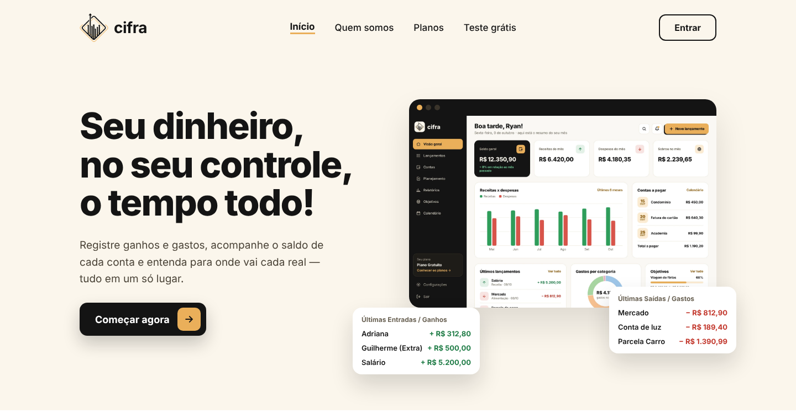

# CIFRA

**Seu dinheiro, no seu controle, o tempo todo.**
Gestão financeira pessoal na web, que também pode ser instalada como app no celular e no computador.



---

## O que a CIFRA faz

**Dia a dia**
- **Visão geral (Painel)**:
  - Saldo geral, Receitas e Despesas do mês e **Sobrará no mês**: saldo do início do mês + receitas − despesas.
  - As despesas incluem as contas fixas previstas e as parcelas a pagar.
  - O cartão Sobrará também mostra "se receber o que te devem".
- **Lançamentos**: ganhos, gastos e transferências.
  - Contas fixas (repetem todo mês), parcelados e comprovante anexado.
- **Contas e cartões**: saldo de cada conta, saldo geral e faturas de cartão de crédito.
  - O primeiro saldo de uma conta nova entra como receita do mês; mudanças depois viram "Ajuste de saldo" (não mexem nos gráficos dos meses passados).
- **Calendário** e **Checklist** do mês, com as parcelas de "A pagar" e "A receber".
  - **Datas do ano** no calendário (feriados, 13º, Imposto de Renda, Black Friday, datas comemorativas): a pessoa escolhe quais aparecem.
- **Objetivos**: guardar dinheiro tirando de uma conta.
- **A receber** e **A pagar**: dívidas com parcelas (total ou valor da parcela), juros por atraso e data de vencimento ajustável.
- **Comprovantes**: fotos e PDFs guardados na conta, organizados em grupos.
- **Relatórios**: receitas x despesas x saldo por semana (Mês) ou por mês (3, 6 meses, ano), gastos por categoria e resumo para enviar no WhatsApp.
- **Orçamento por categoria**, com aviso quando chega na % escolhida.
- **Importar extrato** OFX ou CSV.

**Conta**
- Cadastro com e-mail e senha, confirmação de e-mail e "Esqueci minha senha".
- Os mesmos dados no celular e no computador (sincronização).
- Minha conta: editar dados, trocar senha e excluir a conta (LGPD).
- **Verificação em duas etapas** (opcional): código de 6 números de um app autenticador, pedido no login.
- Tema escuro ou claro, **fundo do painel** (cores, padrões ou uma foto), lembretes e backup.
- **Relatar problema**: botão no menu lateral, que envia o relato para o banco.

**App**
- Instalável (PWA): página **Baixar o app** com passo a passo para Android, iPhone e computador, e QR code.
- Abre sem internet com o que já está no aparelho. O que for lançado offline sobe quando a conexão voltar.

---

## Tecnologias

| Parte | Ferramenta |
|---|---|
| Telas | React 18 + React Router 6 (`HashRouter`, endereços com `#/`) |
| Empacotador | Vite 5 |
| Login e banco de dados | Supabase (Auth, Postgres com RLS, Storage) |
| E-mails (confirmação e nova senha) | Brevo, via SMTP configurado no Supabase |
| Hospedagem | Vercel (publica sozinho a cada `git push`) |
| Gráficos | SVG feito à mão (`src/components/Graficos.jsx`), sem biblioteca |
| QR code | `qrcode` |

---

## Como os dados funcionam

```
 Telas (React)  ──lê/grava──▶  localStorage (cópia rápida, funciona offline)
                                     │
                         nuvem.js observa cada gravação
                                     ▼
                         Supabase: tabela "dados" (uma linha por "gaveta":
                         lancamentos, contas, objetivos, receber, pagar…)
```

- **Ao entrar ou abrir o site:** `nuvem.js` envia o que ficou pendente e depois baixa tudo da conta para o aparelho.
- **A cada mudança:** a chave `cifra:u:<id>:<nome>` é enviada cerca de 1 segundo depois.
- **Sem internet:** a mudança entra numa fila e sobe quando a conexão volta. Um aviso aparece na tela.
- **Ao sair da conta:** o que falta é enviado e a cópia do aparelho é apagada.
- **Segurança:** cada pessoa só lê e grava as próprias linhas. Quem garante isso são as regras **RLS** do banco, não o site.
- **Chave no código:** a chave publicável do Supabase pode ficar no site. A chave `service_role` **nunca** entra no código.

### Tabelas no Supabase

| Tabela / pasta | O que guarda |
|---|---|
| `auth.users` | e-mail e senha (gerenciados pelo Supabase) |
| `perfis` | nome, sobrenome, idade, endereço (sem CPF) |
| `dados` | os dados do app, em texto JSON, por pessoa |
| `relatos` | problemas e sugestões enviados pelo app (só o dono do projeto lê) |
| `auth.mfa_factors` | apps autenticadores da verificação em duas etapas (gerenciados pelo Supabase) |
| Storage `comprovantes/` | arquivos, cada pessoa na pasta `<id>/` |

O SQL de tudo isso está em [`supabase/`](supabase/), na ordem em que foi aplicado.

### Segurança

- **RLS:** cada pessoa só lê e grava as próprias linhas e arquivos. Isso foi testado simulando um ataque entre duas contas.
- **Verificação em duas etapas:** quem ativou só acessa os dados com uma sessão que passou pelo código (`aal2`). A regra fica no banco, não só na tela.
- **Limites por conta:**
  - dados: 60 itens e 20 MB;
  - comprovantes: 300 arquivos e 100 MB;
  - relatos: 10 por dia.
- **Cabeçalhos de segurança** no `vercel.json`:
  - CSP: só carrega código do próprio site e só conversa com o Supabase e o ViaCEP;
  - a CIFRA não pode ser aberta dentro de outro site;
  - `nosniff`, `Referrer-Policy` e `Permissions-Policy`.
- **Chave no código:** a chave publicável do Supabase pode ficar no site. A `service_role` nunca entra no código.

---

## Rodar no seu computador

Precisa do [Node.js](https://nodejs.org) 18 ou mais novo.

```bash
npm install      # instala as dependências (só na primeira vez ou quando mudar o package.json)
npm run dev      # abre em http://localhost:5173 e atualiza sozinho ao salvar
```

Versão final:

```bash
npm run build    # gera a pasta dist/
npm run preview  # confere a versão final em http://localhost:4173
```

O projeto já vem apontando para o Supabase da CIFRA. Para usar outro projeto, crie um arquivo `.env.local`:

```
VITE_SUPABASE_URL=https://SEU-PROJETO.supabase.co
VITE_SUPABASE_ANON_KEY=sua-chave-publicavel
```

---

## Estrutura

```
cifra/
├── index.html                 casca da página (manifest, ícones, fonte)
├── vercel.json                cabeçalhos de segurança do site publicado
├── public/
│   ├── sw.js                  service worker: cache para abrir offline + notificações
│   ├── manifest.webmanifest   nome, cores e ícones do app instalável
│   └── icones/                ícones do app (192, 512, maskable, Apple)
├── supabase/                  SQL do banco (tabelas, regras RLS, funções)
├── docs/                      imagens do README
└── src/
    ├── main.jsx               ponto de entrada: confere o login (nuvem.js) e desenha o App
    ├── App.jsx                rotas e proteção das telas do sistema
    ├── config.js              e-mail e WhatsApp de contato
    ├── styles/global.css      cores (variáveis), tema claro/escuro e estilos básicos
    ├── assets/                logo e fotos
    ├── dados/                 regras e armazenamento (sem tela)
    │   ├── nuvem.js           Supabase: login, sincronização, links de e-mail, sair
    │   ├── usuarios.js        cadastro, entrar, nova senha, minha conta, excluir conta
    │   ├── armazenamento.js   chaves por pessoa no localStorage
    │   ├── acesso.js          atalhos de login para as telas
    │   ├── lancamentos.js     lançamentos, fixas, mês financeiro
    │   ├── contas.js          contas, cartões, faturas, saldo geral
    │   ├── receber.js         A receber: parcelas, juros, recebimentos
    │   ├── pagar.js           A pagar (reaproveita os cálculos do receber.js)
    │   ├── parcelas.js        parcelas no calendário/checklist e no painel
    │   ├── orcamentos.js      limites por categoria
    │   ├── objetivos.js       objetivos ligados às contas
    │   ├── comprovantes.js    arquivos no Supabase Storage + cópia no IndexedDB
    │   ├── alertas.js         avisos de vencimento, orçamento, lembretes
    │   ├── preferencias.js    tema, lembretes, início do mês
    │   ├── relatos.js         "Relatar problema"
    │   ├── instalar.js        instalação do app (PWA)
    │   ├── ofx.js / csv.js    importação de extratos
    │   └── plano.js, cursos.js, noticias.js, resumo.js
    ├── components/            pedaços de tela reaproveitados (menu, gráficos, janelas…)
    └── pages/
        ├── Inicio, QuemSomos, Planos, TesteGratis, BaixarApp      site público
        ├── Entrar, Cadastro, RecuperarSenha, NovaSenha            conta
        ├── Privacidade, Termos                                    documentos
        └── Painel, Lancamentos, Checklist, Contas, Relatorios,
            Calendario, Objetivos, Receber, Pagar, Comprovantes,
            Cursos, Noticias, Configuracoes                        sistema (/painel/...)
```

**Trocar as cores:** edite as variáveis no topo de `src/styles/global.css`. As `--esc-*` são as do tema do painel.

---

## Publicar

1. Faça o commit e o push para a branch `main`:
   ```bash
   git add .
   git commit -m "mensagem"
   git push
   ```
2. O **Vercel** publica sozinho em cerca de 1 minuto.

### Configuração do Supabase (feita uma vez)

- **SQL:** os arquivos de `supabase/` já foram aplicados no projeto.
- **Authentication → URL Configuration:**
  - *Site URL*: o endereço do site no Vercel.
  - *Redirect URLs*: `https://SEU-SITE.vercel.app/**`.
- **Authentication → Emails → SMTP Settings:**
  - Brevo: host `smtp-relay.brevo.com`, porta `587`, login e chave SMTP do Brevo.
  - Sem um SMTP próprio, o Supabase só envia e-mail para membros da equipe do projeto.
- **Authentication → Sign In / Providers → Email:**
  - *Confirm email*: liga ou desliga a confirmação.
  - *Minimum password length*: `8`.
- **Ler os relatos dos usuários:** *Table Editor → relatos*. Marque `resolvido` quando tratar.
- **Plano grátis:** o projeto é pausado depois de cerca de 1 semana sem uso. Para voltar, é só reativar no painel.

---

## Próximos passos

- [ ] Página Planos sem promessas que ainda não existem
- [ ] Entrar com o Google
- [ ] Domínio próprio (ex.: `cifra.com.br`) e e-mails com o nome da CIFRA
- [ ] Avisos de erro (Sentry) e cópia de segurança semanal do banco
- [ ] Pagamento dos planos (Mercado Pago) com bloqueio real dos recursos
- [ ] Notificações com o app fechado e resumo mensal automático no WhatsApp
- [ ] Finanças em casal/família
- [ ] Notícias automáticas
- [ ] Publicar na Play Store (empacotando o app instalável)
